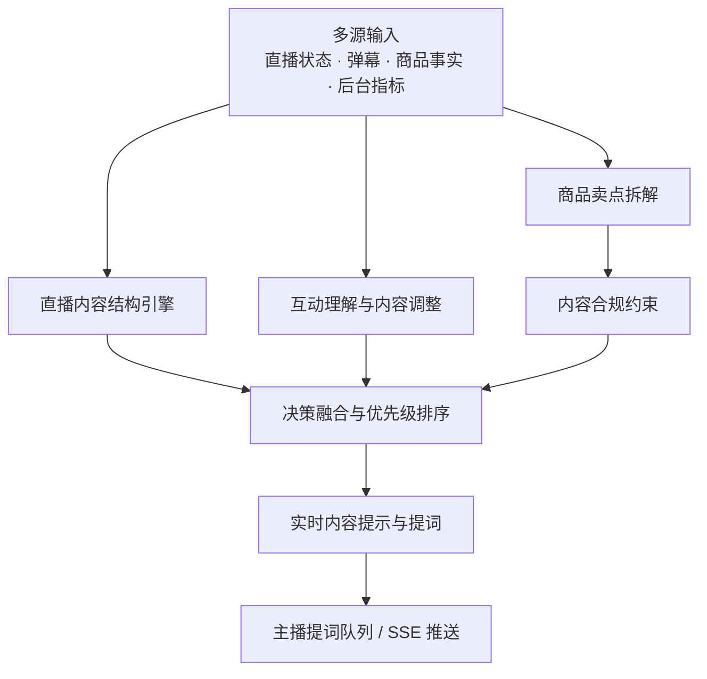

# 架构与数据流

## 决策数据流

`AgentInput` → 阶段引擎 → 互动理解 → 卖点匹配 → 合规过滤 → 决策融合排序 → `AgentOutput`

阶段引擎按时间比例推算当前阶段和下一阶段准备项；若输入包含 `directive.target_stage`，结构化指令优先于时间推算。决策融合从 `config/decision_rules.json` 读取基础分/信号分权重、优先级阈值和冲突策略，把阶段、同问、刷屏、礼物/醒目留言、后台指标等信号合成最终优先级。

`analyze_async` 在规则链路前增加 AI 语义互动分析：DeepSeek 可用时读取本窗口弹幕文本和当前阶段，输出主题、问题、相似问题、刷屏、负面反馈和购买意向；成功后用语义结果替代关键词统计，失败则回退 `InteractionModule`。`interaction_mode` 标明本轮实际使用的方式。

润色阶段会把 `stage_state` 中的当前阶段、阶段目标、阶段重点、下一阶段准备和来源一并传给模型，要求话术按阶段调整语气和推荐动作，同时保留商品事实边界。同一次调用还会生成 `ai_decision_summary`，页面单独显示为“AI 决策摘要”；规则引擎产生的 `decision_notes` 仍作为“调度说明”，解释冲突、同问/刷屏、合规降级和手动阶段指令如何影响排序，两者不混用。

`/live/status` 和 `/live/config` 会带上当前 `stage_state` 预览，手动切换阶段时前端可以立即更新右侧阶段卡，不需要等下一轮弹幕分析。

## 模块接口

各模块通过 `schemas.py` 中的 Pydantic 模型交换数据，不依赖 Web 层或直播平台对象；CLI、Web 回放和实时监听共用同一组接口。

| 模块 | 入口 | 输入 | 输出 | 配置 |
|---|---|---|---|---|
| 直播内容结构引擎 | `LiveStructureModule.evaluate()` | `LiveState`、可选 `StageDirective` | `StageState` | `decision_rules.json` 的 `stages` |
| 互动理解与内容调整 | `InteractionModule.analyze()`；`DeepSeekClient.analyze_interactions()` | `AgentInput`；或弹幕文本 + 当前阶段 | `InteractionResult`（`CommentAnalysis` + `summary` + `mode`） | 模型开关见 `agent.json` |
| 商品卖点拆解 | `ProductCatalog.match_selling_points()`、`SellingPointModule.suggest()` | `Product` 事实 + 互动摘要 | `Suggestion[]` 候选话术 | `products.json` |
| 内容合规约束 | `ComplianceModule.screen()` / `filter()` | 文本；或候选 `Suggestion[]` | 命中/例外明细；已降级候选 | `compliance_rules.json` |
| 决策融合与优先级排序 | `DecisionFusionModule.rank()` | `AgentInput`、候选、`StageState` | `DecisionOutcome`（排序结果 + 调度说明） | `decision_rules.json` 的权重、阈值、冲突策略 |
| 实时内容提示与提词 | `pipeline._analyze_prepared()` / `analyze_async()` | 上述模块输出 | `AgentOutput` | — |

## 直播事件流

`blivedm.BLiveClient` → `_AgentHandler` → `asyncio.Queue[LiveEvent]` → `LiveWindowRunner`（CLI，30 秒窗口）→ 阶段引擎 → 互动分析 → 商品目录匹配 → 提词生成 → 合规预筛 → 决策融合排序

平台消息先转换为项目自己的 `LiveEvent`，使决策模块不依赖第三方消息对象。窗口内的弹幕和醒目留言进入互动分析；礼物和进房互动作为事件信号计数。Cookie 通过 `BILIBILI_COOKIE` 环境变量传给 HTTP/WebSocket session。

CLI 的 `LiveWindowRunner` 将 `examples/scene.json` 作为商品资料、直播计划和后台指标模板，但会把点击率/转化率清零，只保留结构字段；Web 的 `LiveSession` 使用同一模板的直播计划和商品资料，在线人数每 20 秒从 B 站刷新，点击率/转化率保持 `unavailable`。两者都不会把示例指标解释为 B 站实时成交数据。

## Web 演示层

`GET /`（或 `/demo`）返回 `static/index.html`；`GET /demo/bootstrap` 提供阶段计划、预置场景和商品目录；页面提交的 `POST /analyze` 与 CLI 共用同一条决策链路。页面没有构建步骤，样式和脚本分别位于 `static/styles.css` 与 `static/app.js`。

`GET /compliance` 返回只读的合规词库浏览页 `static/compliance.html`，数据来自 `GET /compliance/rules`。主播可以按风险等级、类别和关键词筛选词条与替代方向；该页面只用于浏览，不替代 Agent 的实时合规拦截。

## 实时监听数据流

`BilibiliLiveProvider` → `asyncio.Queue[LiveEvent]` → `LiveSession` → SSE 订阅者 + 10 秒窗口 → `analyze_async` → SSE `analysis` 事件

- 事件类型包括弹幕、礼物、上舰、醒目留言和进房互动；事件视图包含发送者昵称和动作，昵称只在页面展示，不写入互动分析文本、不进入模型输入。
- 每个窗口把弹幕/醒目留言送入互动分析，礼物和互动事件进入事件计数。
- 礼物按金瓜子面值折算（1000 金瓜子 = 1 元，银瓜子礼物计 0 元）；舰长、提督、总督分别累计件数和价值；醒目留言按 `price_rmb` 单列。实时面板同时展示件数与面值。
- 在线人数每 20 秒从 B 站房间信息接口刷新。购物车点击率和转化率没有公开来源，实时页面不展示也不使用；`POST /live/metrics` 仅保留为未来业务数据接入点。
- `providers/simulated.py` 只在本地演示或测试时使用，页面会把数据源标注为“离线模拟源”。

## 当前扩展点

- `src/blivedm/`: 复制的 `blivedm` 源码；保留上游 MIT 许可证
- `providers/bilibili.py`: B 站消息到统一事件模型的适配
- `providers/simulated.py`: 离线实时事件源，仅用于本地演示和测试
- `providers/mock.py`: 示例场景输入
- `live_session.py`: 实时事件缓冲、SSE 广播、窗口自动/手动分析开关和外部指标接入点
- `providers/product_catalog.py` + `config/products.json`: SKU 商品事实、卖点匹配关键词和证据说明
- `modules/live_structure.py` + `config/decision_rules.json` 的 `stages`: 阶段划分、时间规则、下一阶段准备
- `modules/interaction.py`: 关键词意图分类、同问和刷屏文本统计；模型不可用时的回退路径
- `llm/deepseek.py`: AI 语义互动分析、话术润色、JSON 校验与重试；只接收弹幕文本、商品事实、主题计数和候选草稿
- `modules/selling_points.py`: 用户话题与商品卖点匹配、候选话术生成
- `modules/compliance.py` + `config/compliance_rules.json`: 风险词预筛、归一化、否定/转述/询问语境排除、固定搭配例外和替代修改方向
- `static/compliance.html` + `static/compliance.css` + `static/compliance.js`: 只读合规词库浏览页
- `modules/decision_fusion.py` + `config/decision_rules.json`: 多信号加权评分、优先级阈值、促单/答疑冲突处理

合规模块先做全半角、空格、分隔符和常见等价表达归一化，再按长词优先匹配；命中后检查否定/免责、转述/询问和固定搭配语境，能解释地排除“第一步”“不是全网最低”“全网最低吗”等误报。该层是确定性规则，不做模型推理。

风险词命中表示“需要复核”，不直接等同于违法认定。市场监管总局《广告绝对化用语执法指南》要求结合具体广告内容和语境判断；商品功效表述也要依据对应品类的注册、备案、标签和可核验证据。

实时弹幕只是输入之一；在线人数、商品点击和转化率应由独立业务数据源提供。
